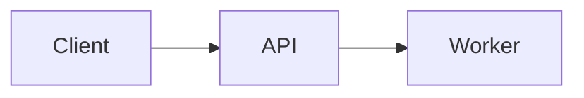

Use diagrams for relationships, tooltips for short definitions, and file trees for directory layouts. These components are available in MDX without imports.

## Draw Mermaid diagrams

Write a `mermaid` code fence to render a diagram. For example, this flow shows a request moving from a client through an API to a worker:

````md

````

<Mermaid chart="flowchart LR; Client --> API; API --> Worker;" />

The component form takes the same diagram source in `chart`:

```mdx
<Mermaid chart="flowchart LR; Client --> API; API --> Worker;" />
```

| Prop | Value | Behavior |
| :--- | :--- | :--- |
| `chart` | String containing Mermaid source | Renders the diagram. Missing or empty source renders nothing. |

Both forms render in the browser and follow the site's light or dark theme. If rendering fails, the diagram source appears as a code block instead. Include the relationship in nearby prose so readers without JavaScript still have the explanation.

## Choose icons

Use `Icon` for an inline glyph. The site-wide `icons.library` setting in `docs.json` accepts `lucide`, `fontawesome`, or `tabler`; the default is `fontawesome`.

To select Lucide naming for the site, merge this setting into `docs.json`:

```json
{
  "icons": {
    "library": "lucide"
  }
}
```

Lucide and Font Awesome identifiers resolve through Margin's mapped icon set, rather than loading those libraries directly. A mapped icon may differ visually from the original library's glyph. `tabler` is best-effort: Margin attempts to resolve names through the same map and warns about that library setting. It does not load the Tabler catalog.

Use bare names such as `arrow-right` (Lucide) or `envelope` (Font Awesome). Do not prepend `fa-solid`, `fa-`, or `tabler:`. Names are case-normalized; `ArrowRight`, `arrow_right`, and `lucide-arrow-right-icon` also normalize to `arrow-right`. The library setting does not prevent mapped aliases from resolving.

These examples use mapped names from each naming vocabulary:

```mdx
<Icon icon="arrow-right" size={20} /> Continue

<Icon icon="envelope" size={20} color="#2563eb" /> Email
```

<Icon icon="arrow-right" size={20} /> Continue

<Icon icon="envelope" size={20} color="#2563eb" /> Email

| Prop | Value | Behavior |
| :--- | :--- | :--- |
| `icon` | Mapped name, local image path, or permitted image URL | Selects the glyph or image. |
| `size` | Number or numeric string | Size in pixels. Defaults to `16`; values must be positive and at most `128`, otherwise the default applies. |
| `color` | CSS color string | Sets the inline SVG color; does not recolor image icons. |
| `iconType` | String | Accepted for compatibility; does not change the icon style. |

An unknown literal icon name produces the default file glyph and an `icon_unresolved` warning during ingest. Authored inline SVG markup is not a valid `icon` value. Use an image file when the mapped set does not contain the required visual.

## Annotate content

### Badge

Use `Badge` for a short, neutral label. Its only component-specific input is its child content; color and size variants are not implemented.

```mdx
<Badge>Preview</Badge>
```

<Badge>Preview</Badge>

### Tooltip

Use `Tooltip` for a short explanation that appears on hover or keyboard focus. Keep required instructions in the page body rather than only in a tooltip.

```mdx
<Tooltip tip="A request identifier used to correlate logs.">
  Request ID
</Tooltip>
```

<Tooltip tip="A request identifier used to correlate logs.">
  Request ID
</Tooltip>

| Input | Value | Behavior |
| :--- | :--- | :--- |
| `tip` | String | Tooltip text. |
| Children | Inline content | Visible, focusable trigger with a dotted underline. |

### Color

Use `Color` for a palette of clickable swatches, not to change the color of arbitrary text. Each `Color.Item` takes a CSS color string or a light/dark pair. Clicking a swatch copies the value for the active theme.

This table groups a theme-aware accent and a fixed color:

```mdx
<Color variant="table">
  <Color.Row title="Interface">
    <Color.Item name="Accent" value={{ light: "#2563eb", dark: "#60a5fa" }} />
    <Color.Item name="Success" value="#16a34a" />
  </Color.Row>
</Color>
```

<Color variant="table">
  <Color.Row title="Interface">
    <Color.Item name="Accent" value={{ light: "#2563eb", dark: "#60a5fa" }} />
    <Color.Item name="Success" value="#16a34a" />
  </Color.Row>
</Color>

| Component | Input | Behavior |
| :--- | :--- | :--- |
| `Color` | `variant="table"` or `variant="compact"`; children | `compact` is the default. Values other than `table` also use compact layout. |
| `Color.Row` | Optional `title`; children | Groups swatches under a label. |
| `Color.Item` | Optional `name`; `value` | Labels and renders one swatch. A theme pair must contain both `light` and `dark` strings. Missing or unsupported values render nothing. |

## Show file structure

`Tree` and `FileTree` are aliases for the same file-tree component. Nest folders and files with member components, not Markdown lists or a text `tree` prop.

This tree opens the `docs` folder initially:

```mdx
<Tree>
  <Tree.Folder name="docs" defaultOpen={true}>
    <Tree.File name="index.mdx" />
  </Tree.Folder>
  <Tree.File name="docs.json" />
</Tree>
```

<Tree>
  <Tree.Folder name="docs" defaultOpen={true}>
    <Tree.File name="index.mdx" />
  </Tree.Folder>
  <Tree.File name="docs.json" />
</Tree>

Use the alias with its own member names when importing existing `FileTree` markup:

```mdx
<FileTree>
  <FileTree.Folder name="images">
    <FileTree.File name="logo.svg" />
  </FileTree.Folder>
</FileTree>
```

<FileTree>
  <FileTree.Folder name="images">
    <FileTree.File name="logo.svg" />
  </FileTree.Folder>
</FileTree>

| Component | Input | Behavior |
| :--- | :--- | :--- |
| `Tree` / `FileTree` | Children | Contains folder and file entries. |
| `.Folder` | `name`, children | Displays a named, collapsible folder. |
| `.Folder` | `defaultOpen` | Boolean, default `false`. Opens the folder initially when `true`. |
| `.Folder` | `disabled` | Boolean. Disables the folder toggle. |
| `.File` | `name` | Displays a file entry. |

## Add supporting components

### GitHub

Use `GitHub.Repo` to link to a public repository and show its description, star count, and fork count. The root `GitHub` component only passes through its children; it does not create a card by itself.

This example displays Margin's repository:

```mdx
<GitHub>
  <GitHub.Repo repo="maniculehq/margin" variant="inset" />
</GitHub>
```

<GitHub>
  <GitHub.Repo repo="maniculehq/margin" variant="inset" />
</GitHub>

| Prop on `GitHub.Repo` | Value | Behavior |
| :--- | :--- | :--- |
| `repo` | `owner/name` or a GitHub repository URL | Required to render a repository link. Invalid or missing values render nothing. |
| `variant` | `inset` or `flat` | `flat` removes the bordered card treatment. Omitted or other values use the inset treatment. |
| `className` | String | Adds CSS classes to the repository link. |

Repository metadata is fetched from GitHub in the visitor's browser and cached for the session. While loading, or if GitHub refuses the request, the component remains a repository-name link. Private-repository access is not configured by this component.

### Prompt

Use `Prompt` to offer text for copying into an AI tool. The visible card shows the description and actions; the prompt body is hidden, but the actions use its full text.

This example adds actions that open the prompt in Claude Code, Codex and Cursor alongside Copy prompt:

```mdx
<Prompt description="Review a retry policy" actions={["copy", "claude", "codex", "cursor"]}>
  Review the retry policy for this API client. Identify requests that
  cannot be retried safely and explain how to handle them.
</Prompt>
```

<Prompt description="Review a retry policy" actions={["copy", "claude", "codex", "cursor"]}>
  Review the retry policy for this API client. Identify requests that
  cannot be retried safely and explain how to handle them.
</Prompt>

| Input | Value | Behavior |
| :--- | :--- | :--- |
| `description` | String | Visible label. Defaults to `Prompt`. |
| `actions` | Array of `copy`, `claude`, `codex` and `cursor` | Defaults to `["copy"]`. Copy is always visible. `claude` adds Open in Claude Code, `codex` adds Open in Codex, and `cursor` adds Open in Cursor, in the order listed. Invalid arrays fall back to `["copy"]`. |
| Children | Prompt content | Text copied, or sent to the chosen client's deep link. |

`Prompt` does not run a model request or display a model response.

### Update

Use `Update` for a dated release entry. It places the label, description, and tags beside the body on wider screens and above the body on narrow screens.

This minimal entry separates the release metadata from its content:

```mdx
<Update label="2026-01-15" description="Retry controls" tags={["API"]}>
  Configure retry behavior for the API client.
</Update>
```

<Update label="2026-01-15" description="Retry controls" tags={["API"]}>
  Configure retry behavior for the API client.
</Update>

| Input | Value | Behavior |
| :--- | :--- | :--- |
| `label` | String | Displayed label and source for the entry anchor. |
| `date` | String | Fallback for `label` when `label` is omitted. |
| `description` | String | Short release description beside the label. |
| `tags` | Array of strings | Displays tag labels. Missing or invalid arrays use an empty array. |
| Children | Entry content | Release body. |

The anchor lowercases the label or fallback date, replaces runs of non-alphanumeric characters with hyphens, and removes leading and trailing hyphens. The example entry has anchor `#2026-01-15`.

See [Publish changelogs](/content/changelogs) for the changelog workflow.
