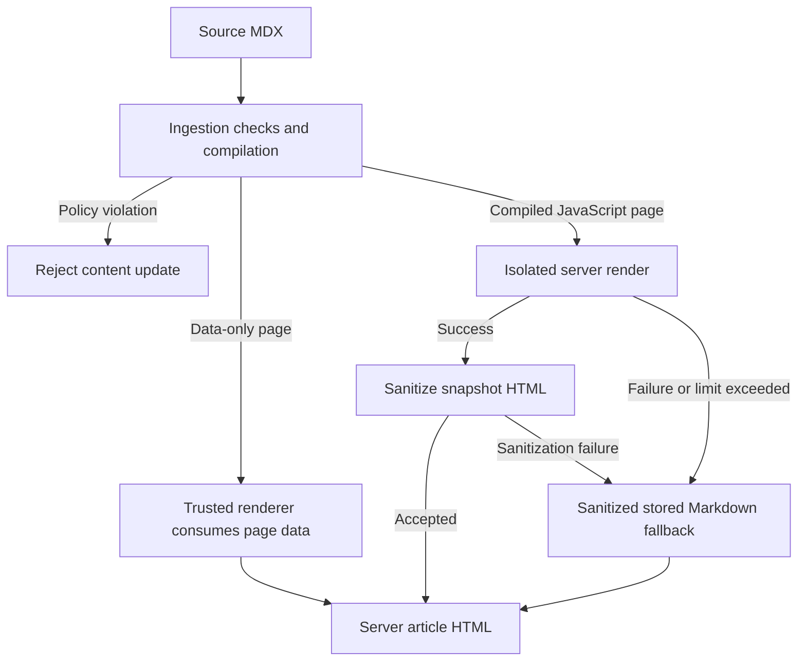

Margin can render site-authored MDX without giving that code access to the server hosting the documentation. Ingestion checks the content first; pages that need JavaScript receive a server snapshot from a restricted V8 runtime. If that render fails, Margin serves a sanitized text-oriented article instead of executing the page on the host.

## Separate host code from site content

Site content includes MDX expressions and code imported from supported snippets. Treat this code as untrusted even when it lives in the documentation repository. It does not receive the server's filesystem, network clients, environment variables, or application objects.

Trusted framework code can render a data-only page tree on the host. That does not execute site-authored JavaScript: pages with dynamic expressions or JavaScript snippet bindings use the isolated render path instead. Host extensions belong to a different trust boundary. See [extensions](/extend/extensions); trusted extension code does not run inside the content sandbox.

The server boundary is not a browser sandbox. Compiled MDX also runs in the visitor's browser after hydration. A server rendering failure does not disable that browser execution.

This flow separates ingestion rejection from the readable fallback used after a server rendering failure:



## Constrain MDX during ingestion

Ingestion checks the parsed MDX syntax tree, not just the source text. Ordinary Markdown, fragments, permitted lowercase HTML, built-in components such as `Steps` and `Callout`, and supported snippet bindings can pass this check. Expressions are not categorically banned; expressions that need JavaScript take the isolated server render path.

Unsupported constructs do not all have the same outcome:

| Construct | Ingestion behavior |
| --- | --- |
| Unknown capitalized component or unsupported built-in member | Emits `component_unknown` and replaces the component with its children. The component's layout and attributes do not survive. |
| Unsupported import/export remaining after snippet processing | Emits `esm_stripped` and removes the statement. A use of the removed binding can still fail later. |
| Supported imports under `/snippets/` | Processed before the allow-list; imported component names can be used in the page. |
| Spread attributes, attributes beginning with `on` (case-insensitive), `srcdoc`, or attributes beginning with `data-rail` | Records a policy violation; ingestion rejects the content update. |
| Denied elements or disallowed URL schemes | Records a policy violation; ingestion rejects the content update. |
| Raw HTML blocks in plain `.md` files | Records a policy violation; ingestion rejects the content update. Use Markdown rather than raw HTML blocks in those files. |

Built-in member syntax is limited to `Tree.File`, `Tree.Folder`, `FileTree.File`, `FileTree.Folder`, `Color.Item`, `Color.Row`, and `GitHub.Repo`. Snippet-bound components can define their own members.

The denied HTML and SVG elements are `script`, `object`, `embed`, `style`, `link`, `meta`, `base`, `frame`, `frameset`, `noscript`, `foreignObject`, `animate`, `set`, `animateMotion`, and `animateTransform`. Inline SVG is otherwise permitted. An authored `iframe` requires a static string `src` starting with `https://`; a computed source or `srcdoc` is not accepted.

URL checks cover Markdown links, images, and reference definitions, plus literal URL-bearing JSX attributes. Accepted schemes are `http`, `https`, `mailto`, `cursor`, `vscode`, and `vscode-insiders`; relative URLs and same-page anchors are also accepted. This does not make every URL valid for every element: the iframe rule is stricter.

A built-in callout with literal attributes passes these checks:

```mdx
<Callout title="Before deploying">
  Check that the page renders in preview.
</Callout>
```

An inline event handler is a policy violation, even on an otherwise permitted element:

```mdx
<button onClick={() => alert("clicked")}>Run</button>
```

## Render within an isolated runtime

For a compiled JavaScript page, Margin evaluates the render bundle inside a V8 isolate. Each page render receives a fresh context, so site globals do not persist into the next page render. Site code can compute markup but receives no `process`, `require`, `fetch`, timers, DOM, or host filesystem access. Server rendering also does not run React effects.

| Constraint | Configured limit |
| --- | --- |
| Site render execution timeout | 250 ms wall-clock timeout, not a CPU-time quota |
| Isolate heap | 128 MB |
| HTML returned from the isolate | 2,097,152 UTF-16 code units; despite the limit's byte-oriented name, enforcement uses JavaScript string length |
| HTML nesting before snapshot sanitization | Maximum checked depth of 512 elements; the conservative depth check can reject markup before full parsing |

Successful output is still untrusted HTML. Before serving it, Margin drops denied elements with their contents, removes inline event handlers and `srcdoc`, checks URL-bearing attributes, and only keeps iframes with HTTPS sources. The renderer's image-preload link is a specific exception to the general ban on `link` elements.

## Handle rendering failures

The fallback applies to a compiled JavaScript page whose server render is declined. It does not repair content that ingestion rejected.

| Render result | Cause |
| --- | --- |
| `timeout` | Site execution exceeds its timeout. |
| `memory` | Site execution causes the isolate to be disposed for exceeding its memory limit. |
| `oversized` | Rendered HTML exceeds the output string limit. |
| `throw` | Site execution throws, or snapshot sanitization fails, including excessive nesting. |
| `unavailable` | The isolated runtime cannot be loaded or initialized. |

Readers receive server HTML derived from the page's stored processed Markdown, not the failed JavaScript output. Markdown prose, headings, lists, and code remain readable. Component wrappers become their children; literal titles, labels, and field names become lead text where available. Imports and exports are removed. Statically evaluable string or number expressions can remain as text, but other expressions are dropped. Raw HTML is omitted, and the result is sanitized again.

The fallback cannot preserve component interactivity or reproduce computed content that was omitted from the stored Markdown. With JavaScript disabled, readers keep this static article. With JavaScript enabled, the live MDX component replaces the snapshot after hydration; the server timeout does not impose a browser execution limit.

## Write content that fits the model

Keep instructions, expected results, and failure recovery in Markdown children rather than generating essential prose in expressions. A component title can survive fallback, but an empty component whose content comes entirely from code may contribute no useful explanation.

Use built-in components or supported snippet imports instead of package imports or unknown component names. Check ingestion warnings: an unwrapped component can leave readable text while losing the layout the instructions depend on.

Keep render-time computation bounded and free of network or filesystem dependencies. Put browser-only work in a supported client component's effect rather than its render function, and provide static explanatory content for readers who cannot run JavaScript. Show code intended for readers to execute inside fenced code blocks rather than as executable MDX.
